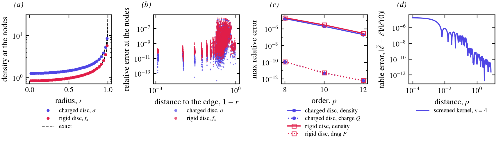
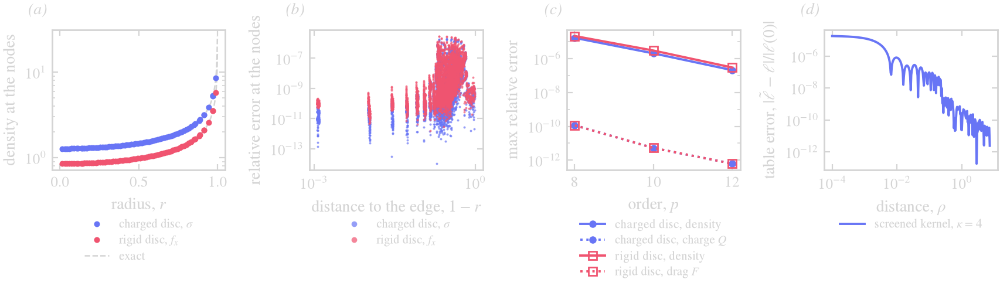
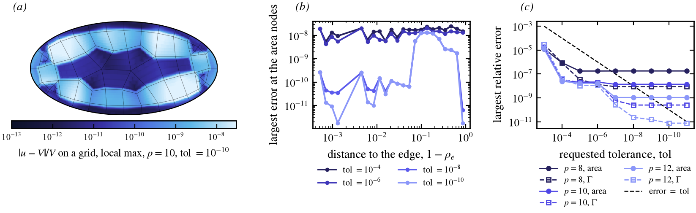
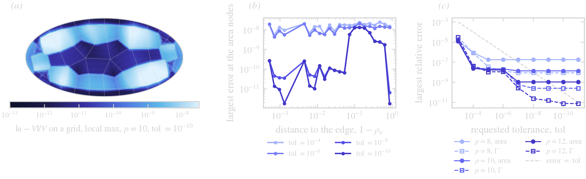

# Examples

The scripts in `examples/` evaluate or solve a problem with an exact solution and print their errors. They need
only OpenSurfaces; run one from the package root:

```
julia -t 8 --project examples/charged_disc.jl
```




*(a)* The densities solved at p = 10 (5500 nodes, one edge layer) along a radius, against the exact edge-singular
densities (dashed): the charged disc, ``\sigma = 4/(\pi\sqrt{1 - r^2})``, and the rigid disc's traction,
``f_x = 8/(3\pi\sqrt{1 - r^2})``. *(b)* The relative error at every node against the distance to the edge: below
2e-10 (``\sigma``) and 1.3e-9 (``f``) within 0.05 of the edge, where the densities are singular; the largest errors,
2.0e-6 and 3.0e-6, are in the interior. *(c)* Convergence in p: the largest density error falls from 1.7e-5 / 2.1e-5
at p = 8 to 2.1e-7 / 3.0e-7 at p = 12 (charged / rigid), and the relative error of the total charge ``Q = 8`` and of
the drag ``F = 16/3`` from 1.2e-10 / 1.1e-10 to 6.3e-13 / 6.2e-13. *(d)* The table error of the screened kernel's
remainder ``\ell(\rho) = (e^{-\kappa\rho} - 1)/(4\pi\rho)``, ``\kappa = 4``, relative to ``|\ell(0)|``: 1.8e-5 at
``\rho = 0``, 8.9e-8 for ``\rho \ge 0.1``, 4.6e-10 for ``\rho \ge 1``.

## First-kind equations on the disc

**`charged_disc.jl`**: a conducting disc at potential 1, the first-kind equation
``\int_\Omega \sigma(y)/(4\pi|x - y|)\,dA_y = 1`` on the unit disc, solved densely (`evaluator_matrix` of an
`Evaluator` of `LaplaceKernel3D` with the stored, edge-weighted density, and `\`). Exact:
``\sigma = 4/(\pi\sqrt{1 - r^2})`` and the capacitance ``Q = 8``. At p = 8, 10, 12 (3584 to 7920 nodes) the density
is within 1.7e-5, 2.0e-6, 2.1e-7 and the charge within 9.3e-10, 4.2e-11, 5.0e-12.

**`rigid_disc.jl`**: a disc translating with velocity ``e_x`` in the free surface of a fluid half-space of viscosity
1, the same solve with `Stokeslet3D()`. Exact: the traction ``f = 8/(3\pi\sqrt{1 - r^2})\,e_x`` and the drag
``F = 16/3`` (``32\mu_f a U/3`` for a disc moving edgewise in an unbounded fluid of viscosity ``\mu_f = 1/2``).
The traction is within 2.1e-5, 3.0e-6, 3.0e-7 and the drag within 6.1e-10, 2.8e-11, 3.3e-12 at p = 8, 10, 12.

Both use one edge layer (`edge_layers = 1`): a ``d^{-1/2}`` density continues into the graded layers, which are not
weighted ([Limits](@ref "Graded layers and edge-singular densities")).

## Pointwise errors




**`ellipse_single_layer.jl`**: the 3D Laplace single layer on the ellipse with semi-axes ``a = 2``, ``b = 1`` of the
density ``\sigma = 1/\sqrt{1 - x^2/a^2 - y^2/b^2}``, the charge density of a conducting elliptic disc, whose
potential is the constant ``V = b\,K(e)/2`` on all of ``\Omega`` (``K`` the complete elliptic integral of the first
kind, ``e^2 = 1 - b^2/a^2``). It is evaluated with one `Evaluator` (one fast sum) at three target sets: the area
nodes, the nodes of ``\Gamma``, and 160 points of ``\Omega`` off the mesh, down to ``10^{-6}`` from the edge; every
target has its own error ``|u - V|/V``.

*(a)* The error on a 321 × 161 grid of points of ``\Omega`` at p = 10 and tol = 1e-10, far below the floor set by p,
with the panels drawn (the largest error within three grid cells: the signed error changes sign inside the panels).
It is set panel by panel, because the corrections integrate the density's interpolant on the panels around each
target: about 1e-8 on the large interior panels next to the edge layer, which resolve the steep part of
``\sigma = 1/\omega`` least well, and about 1e-11 on the central panels. *(b)* The largest error against the distance to the edge, ``1 - \rho_e``
(``\rho_e = \sqrt{x^2/a^2 + y^2/b^2}``), at p = 10: at tol 1e-4 and 1e-6 it is about 1e-8 everywhere; from tol 1e-8
it falls to about 1e-10 near the edge and stops at 1.4e-8 in the band, the same at 1e-10. *(c)* The largest error
against tol for p = 8, 10, 12. The error is far below tol (at tol 1e-4, 9e-7 at p = 8 and 2.5e-8 at p = 10, 12) until
it reaches a floor set by p, the resolution of the density on the panels: 1.8e-7, 1.4e-8 and 1.1e-9 at the area
nodes, 8.6e-9, 2.5e-10 and 7.6e-12 on ``\Gamma``. Below the floor, tol buys nothing and p does. Only at tol 1e-3 is
the error (1.2e-5 to 3.1e-5) within a factor 100 of tol.

## Potentials

**`single_layer_disc.jl`**: `SingleLayer3D` of the unit density on the unit disc against
``S_\Omega[1] = E(r^2)/\pi``, at the area nodes and on ``\Gamma`` (where it is ``1/\pi``): 1.2e-8 and 3.6e-9 at the
default tol, 6.6e-12 and 2.3e-12 at tol 1e-8.

**`stokes2d_curve.jl`**: the 2D Stokes single layer on a curve, with `slp2d_velocity_matrix`,
`traction_self_matrix`, and an `Evaluator` of line sources. On a five-armed star (1020 nodes), ``S[n] = 0`` on
``\Gamma`` (2.1e-13) and at 440 targets inside down to 1e-6 from it (6.8e-13), and the interior traction of ``S[n]``
is ``n`` (6.1e-15); on circles of radius ``a``, a constant density gives ``a(1/4 - \tfrac12\log a)`` on ``\Gamma`` and
inside (to 5e-15).

## Kernels from symbols

**`screened_kernel.jl`**: the screened kernel ``e^{-\kappa\rho}/(4\pi\rho)``, ``\kappa = 4``, from its symbol
``1/(2\sqrt{k^2 + \kappa^2})`` on the base `LaplaceKernel3D()`. Its remainder decays only algebraically in ``k``, so
the constructor warns (see [Kernels from Fourier symbols](@ref method-symbols)). The table is within 1.8e-5 of
``|\ell(0)|`` (9.4e-8 for ``\rho \ge 0.1``), and ``S_\kappa[1]`` on the unit disc, against a polar-ray reference, within
6.5e-9 at tol 1e-6 and 1.8e-9 at tol 1e-8.

## Geometry

**`holes_and_drops.jl`**: two drops, an ellipse with two holes and a disc, discretized together
(`discretize_curves`) and meshed (`build_mesh` on `[[outer, hole₁, hole₂], [drop₂]]`): 64 boundary panels, 341 area
panels, 34,100 nodes; `mesh_quality`; the area of the panels against the exact area (4.8e-14) and the second moment
of the disc against ``\pi R^4/2`` (4.2e-16).
