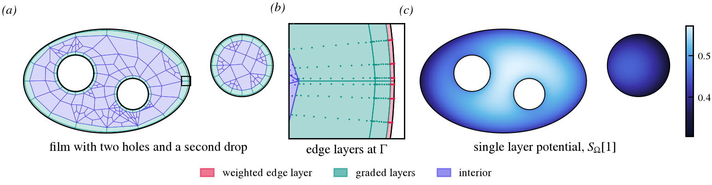
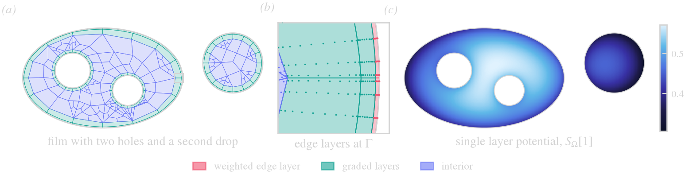

# OpenSurfaces.jl




OpenSurfaces computes integrals of singular kernels over a flat open surface ``\Omega \subset \mathbb{R}^2`` (a
domain in the plane ``z = 0``, possibly with holes and several components) and over its edge ``\Gamma = \partial\Omega``:

```math
u(x) = \int_\Omega K(x - y)\,\mu(y)\,dA_y, \qquad v(x) = \oint_\Gamma K(x - y)\,\nu(y)\,ds_y,
```

at the nodes of the mesh, on ``\Gamma``, or at any points of the plane, to a tolerance you set. The kernels are the
standard ones of potential theory and slow flow (the 2D and 3D Laplace kernels, the 2D Stokeslet and its traction,
the in-plane block of the 3D Stokeslet, modified Helmholtz), kernels you write as functions, and kernels built from
their Fourier symbols. It does four things for you:

- **Meshes the domain from its boundary.** Adaptive high-order panels on ``\Gamma`` from a parametrization, and an
  area mesh of quadrilateral panels with a layer on ``\Gamma`` graded toward it, where the densities of first-kind
  equations on open surfaces have their ``d^{-1/2}`` edge singularity (``d`` the distance to ``\Gamma``): it is
  folded into the quadrature weights, so it costs nothing.
- **Corrects the quadrature where the kernel is singular.** Targets on a panel, on its side, at its corner, on
  ``\Gamma``, or just off it get accurate local weights; everything else uses the plain rule.
- **Sums the rest fast.** FMM (2D and 3D), Ewald splitting with NUFFTs, or direct sums, chosen by the kernel.
- **Builds kernels from their symbols.** A radial kernel known by its Fourier transform (a finite depth, a
  screening length, an embedded membrane) is a standard kernel plus a smooth remainder, tabulated once.

It knows nothing of the physics behind the kernels: a model passes its own in.

## In one call

```julia
using OpenSurfaces

# the unit disc at p = 10: boundary panels, then the boundary nodes and the area mesh
pans = discretize_curve(θ -> Vec2(cos(θ), sin(θ)), 10)
bd, ad, _ = build_mesh(pans, 10)

# the 3D Laplace single layer of a unit density on the disc: S[1] = E(r²)/π (complete elliptic integral)
S = SingleLayer3D(ad)
u = single_layer(S, ones(length(ad)))       # within 2e-8 of E(r²)/π at the default tol
```

## What it offers

| | |
|:--|:--|
| Geometry | adaptive boundary panels from a parametrization; area meshes (by Gmsh) with graded edge layers, holes, several components; mesh quality, interpolation |
| Kernels | Laplace (2D, 3D), 2D Stokeslet, pressure and traction, the in-plane half-space Stokeslet, modified Helmholtz; any callable `K(r)` or `K(i, r)`; `SymbolKernel` from a Fourier symbol |
| Quadrature | local corrections for area sources (polar rules on the panel, adaptive near it) and line sources (log product rules on ``\Gamma``, adaptive near it), as sparse matrices |
| Fast sums | FMM2D, FMM3D, Ewald + NUFFT (3D Stokeslet, a whole 2D + 3D film operator on one grid), smooth convolutions |
| Evaluators | `Evaluator` (any kernel, area or line sources, any targets) as a function and as a linear operator for Krylov solvers, its dense matrix and diagonal blocks; `SingleLayer3D`, `VolumePotentials` |

## Where to go next

- [Getting started](@ref): installation, a mesh, densities, an evaluator, operators and solves, kernels of your own.
- [Method](@ref "Method overview"): the geometry, the quadrature, the fast sums, kernels from symbols, and the limits.
- [Examples](@ref): scripts that solve or evaluate against exact solutions.
- [API reference](@ref) and the [Code map](@ref): every function, and which feature runs it.
