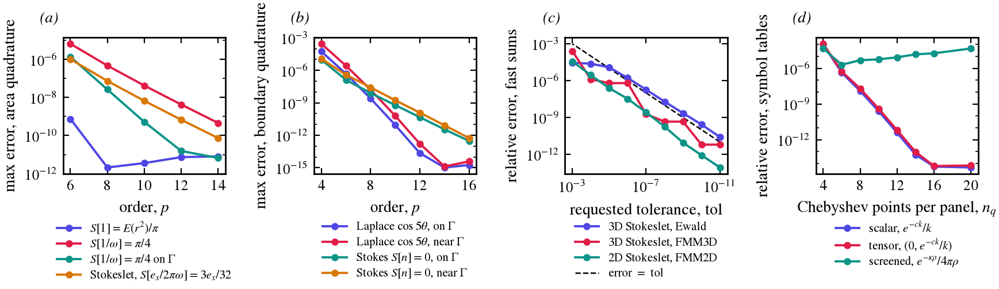
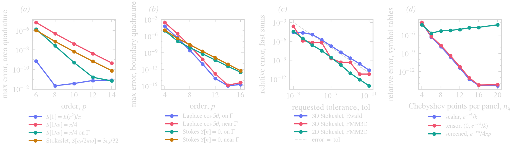

# Method overview

Every potential in OpenSurfaces is computed the same way. With nodes ``y_j`` and weights ``w_j`` of the mesh, the
plain quadrature rule

```math
u(x_i) \approx \sum_{j} K(x_i - y_j)\, w_j\, \tilde\mu_j
```

is accurate wherever the kernel is smooth on the scale of the panels; near a target it is not, since ``K`` is
singular at ``r = 0``. So the plain rule is summed over all pairs by a fast method (coincident pairs skipped), and a
sparse correction ``C`` replaces it, for each target, on the few panels near it by weights that integrate the
singularity:

```math
u = \underbrace{\textstyle\sum_{j \ne i} K(x_i - y_j)\, w_j\, \tilde\mu_j}_{\text{fast sum}} + (C\tilde\mu)_i,
\qquad C = (\text{accurate weights}) - (\text{plain weights}) \ \text{on the near panels}.
```

`Evaluator` holds the pieces: the fast sum, chosen by the kernel's type; the corrections, built once; the
bookkeeping of targets and density forms. Each piece has its own page:

1. [Geometry](@ref method-geometry): boundary panels from a parametrization, and the area mesh with its graded edge layer, where a
   density's ``d^{-1/2}`` edge singularity goes into the weights.
2. [Quadrature](@ref method-quadrature): the local corrections, for area sources (polar rules for targets on a panel, adaptive
   subdivision for targets near it) and line sources (log product rules on ``\Gamma``, adaptive near it).
3. [Fast sums](@ref method-fast-sums): FMM2D and FMM3D with their normalizations and coincident points, Ewald splitting with NUFFTs,
   and smooth convolutions.
4. [Kernels from Fourier symbols](@ref method-symbols): a standard kernel plus a remainder tabulated by Hankel transforms, and
   where the remainder goes in each of the above.

[Limits](@ref) lists what the method does not do, and where it needs care.

## Validation




*(a)* Area quadrature on the unit disc (16 boundary panels at every p, tol 1e-10), the largest error against
closed forms: ``S[1] = E(r^2)/\pi`` reaches about 1e-11 (the level of the fast sum) by p = 8; ``S[1/\omega] = \pi/4``
with the edge-singular stored density falls from 6.7e-6 to 4.6e-10 at the area nodes and from 1.4e-6 to 6.6e-12 on
``\Gamma``, and the Stokeslet identity ``S[e_x/2\pi\omega] = (3/32)\,e_x`` (``\mu_{3D} = 2``) from 1.0e-6 to 7.4e-11,
for p = 6 to 14. *(b)* Boundary quadrature at tol 1e-12, on ``\Gamma`` and at targets down to 1e-8 from it: the 2D
Laplace single layer of ``\cos 5\theta`` on the unit circle against ``-r^5\cos 5\theta/10`` reaches about 1e-15 by
p = 14; the 2D Stokes identity ``S[n] = 0`` on a five-armed star falls from 1.2e-5 to 5.6e-13 for p = 4 to 16.
*(c)* Fast sums against direct sums on the 13,900 nodes of an ellipse mesh, against the requested tol (dashed:
error = tol): FMM3D and FMM2D stay at or below tol; the Ewald sum is within 1.1–2.7 × tol for tol ≤ 1e-5 and levels
off near 3e-5 at looser tol. *(d)* Tables of `SymbolKernel` remainders against closed forms, by Chebyshev points per
panel ``n_q``: an exponentially decaying pair, scalar and tensor, converges spectrally to 5e-15 at ``n_q = 16``; the
screened kernel ``e^{-\kappa\rho}/4\pi\rho``, whose remainder decays only algebraically in ``k``, levels off at 2e-6 to
5e-5, an error concentrated at ``\rho \to 0`` ([Limits](@ref)).

The tests (`test/`) check these at the production settings against exact or direct references; the opt-in
validation tier (`test/validation/run_all.jl`) runs the convergence sweeps behind them.
